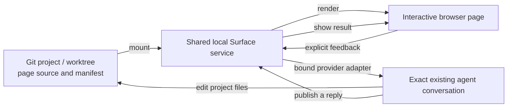
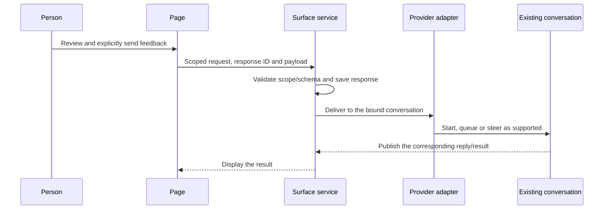

# How Surface works

Surface explores a capability: can a useful interface leave an AI conversation while remaining connected to the agent that understands the work?

The implementation is a way to test that question. This guide explains its current design through one example: an agent creates an architecture review page, a person comments on a diagram, and the comment returns to the original conversation.

This is a learning guide, not another specification. The linked contracts own exact behavior; the [vision](intent/vision.md) owns the goals and future direction.

## The three things that must stay connected

A chat conversation has context. A project has versioned source. A browser page gives a person something to use. Surface connects them without making them the same resource.



The agent still uses its normal tools to edit files. Surface routes the interaction and displays the reply; it does not itself interpret the comment and rewrite the project.

## 1. A project owns the page

The agent creates ordinary Svelte page source inside a Git project. A source might look like this:

```text
project/
  surface.project.json       project and surface identities; source location
  review/
    surface.json             page discovery and route configuration
    package.json             source dependencies
    bun.lock                 frozen dependency resolution
    routes/
      +page.svelte           the review page
      history/
        +page.svelte         a second route
```

`review/` is an example name. Neither `review/` nor `surfaces/` is a special required directory. The project manifest records the source location. Source must satisfy the containment and runtime rules in the [page runtime contract](architecture/page-runtime.md).

This keeps an interface reviewable alongside the work it describes. Git can compare, revert and merge the page and its declarations. It does not automatically version database contents, browser drafts or conversation credentials.

## 2. Registration and mounting make it available

Registration establishes the current worktree's identity in the shared service. Adding a surface records its existing source. Mounting validates and prepares that source, discovers routes and makes the pages available through the runtime.

These are separate operations: recording a definition is not proof that a page can render. For example, an incompatible or integrity-mismatched dependency lock can make mounting fail while the project definition remains intact.

The service returns the actual route and namespace. The browser uses that returned URL; names are readable labels, not substitutes for stable IDs.

**Mounting does not upload the page into a document store.** The runtime reads the project-owned source, so its directory must remain available. Supported source edits use the live compiler and HMR; changing Surface's own built shell requires a new build/release. Exact authoring and mounting steps belong to the [page guide](../skills/surface/references/pages.md), and admission rules belong to [project operations](architecture/project-operations.md).

## 3. A binding connects the original agent

The page can be browsed without an agent connection. To send input back, the agent introduces the exact existing conversation and its supported control endpoint to Surface. A binding connects that conversation with the canonical project root. An interaction request connects the binding with the mounted page and expected payload schema.

An open conversation elsewhere, a display name or the most recently used thread is not sufficient. The useful property is continuity with the conversation that already understands this work.

Provider independence comes from the adapter boundary. The browser submits to Surface; it does not need to speak a provider's control protocol. An adapter translates supported delivery operations into that provider's protocol. The current implementation documents a Codex adapter; additional providers require concrete adapters and acceptance evidence. The goal is broader than the currently verified integrations.

## 4. The person sends an observation

The person can use page controls or select an element, capture a detail and compose contextual comments. A domain form and a contextual comment are related interaction paths, but the project owns the meaning of its form data.

For example, “this dependency seems unnecessary” is feedback for the agent to interpret. It is not an automatic instruction for Surface to delete a file.



An idle conversation can be continued. For an active recipient, the person explicitly chooses queue or steer. The service rechecks the observed recipient state; it must not silently pick another conversation or delivery mode after a mismatch.

The browser receives a capability scoped to the request. Management credentials stay outside page code. Exact request, recipient and delivery rules live in the [interaction contract](requirements/agent-interaction.md).

## 5. Acknowledgement and completion are different

Saving a response, accepting delivery and completing agent work are different events. A queued comment has not necessarily been read or acted on. An agent reply also does not establish that the person accepts the result.

Transport failures make this distinction practical. Surface retains response identities and delivery records so an uncertain acknowledgement can be inspected rather than blindly sending the same work again under a new identity. The project does not claim exactly-once agent execution.

The agent publishes a reply against the corresponding request. It may also edit the source; those edits appear through the supported page runtime. A published reply and a source update are separate effects.

## Why one service can serve multiple worktrees

A project identity and its surface declarations live in Git. Each linked worktree receives a distinct workspace identity and runtime namespace. A shared service can therefore host parallel versions without starting a second service or copying runtime state into each checkout.

| Concern | Owner | What a Git merge does |
| --- | --- | --- |
| Page code, source configuration and dependency locks | Project/worktree | Merges source changes through the normal Git workflow |
| Workspace identity and observed mounts | Shared service with Git worktree identity | Does not merge registrations or runtime state |
| Conversation binding and delivery history | Surface service | Does not transfer requests to another conversation |
| Comment drafts and interaction results | Their documented browser/service stores | Does not turn them into versioned page content |
| Optional domain data | Project backend in its workspace data directory | Does not merge databases |

This design enables parallel work while making reconciliation explicit. It does not make copied project identities, removed source directories or arbitrary directory moves automatically valid. See the [workspace contract](architecture/workspace-service.md).

## Local hosting and remote access

The selected installed release runs a local service. Tailscale Serve can provide a private HTTPS route from another device on the tailnet to that same service. It does not create a second page copy, choose an agent conversation or make provider connectivity work on its own.

The supported mount is trusted local Svelte code. Pages share a runtime/origin; this is not an untrusted-code sandbox or a public multi-user hosting platform. Browser access and permission to deliver input to a conversation are distinct checks.

## Where to read the implementation

| Question | Entry point |
| --- | --- |
| How are the compiler, services and presentation composed? | [Host](../apps/surface/src/lib/server/host/host.ts) and [component collaboration](architecture/components.md) |
| How are project definitions and mount operations handled? | [Project service](../apps/surface/src/lib/server/services/projects.ts) and [project operations](architecture/project-operations.md) |
| How does a page communicate with Surface? | [Page interaction client](../apps/surface/src/lib/interactions/index.ts) |
| How does input reach the agent? | [Interaction service](../apps/surface/src/lib/server/services/service.ts) and [Codex adapter](../apps/surface/src/lib/server/agent-adapters/codex.ts) |
| Where do modules and lifecycle tooling belong? | [Package boundaries](architecture/package-boundaries.md) and [release distribution](architecture/release-distribution.md) |

CLI and MCP are entry points to shared operations. A skill teaches agents how to use those operations; it is not a second runtime or an additional permission grant.

## What the experiments establish

The important questions are observable: did the exact page render, did input reach the intended conversation under the intended conditions, did a result return, and did source/data survive the lifecycle being tested?

Use the [evaluation index](evaluations/README.md) for acceptance requirements, [self-owned E2E](evaluations/self-e2e.md) for the actual interaction scenarios, and [history](history/2026-10-05-navigation-and-design.md) for one dated installed-release result. A past passing test is evidence for its tested revision, not proof that every later build or provider works. Automated phone-sized browser tests are not physical-device or human acceptance.

The next exploration is [typed, templated, persisted pages](requirements/template-pages.md): editable document/tool instances with explicit content and view state. That direction builds on the interaction loop, but a general persistent document editor and unrestricted provider support are not implemented claims.
